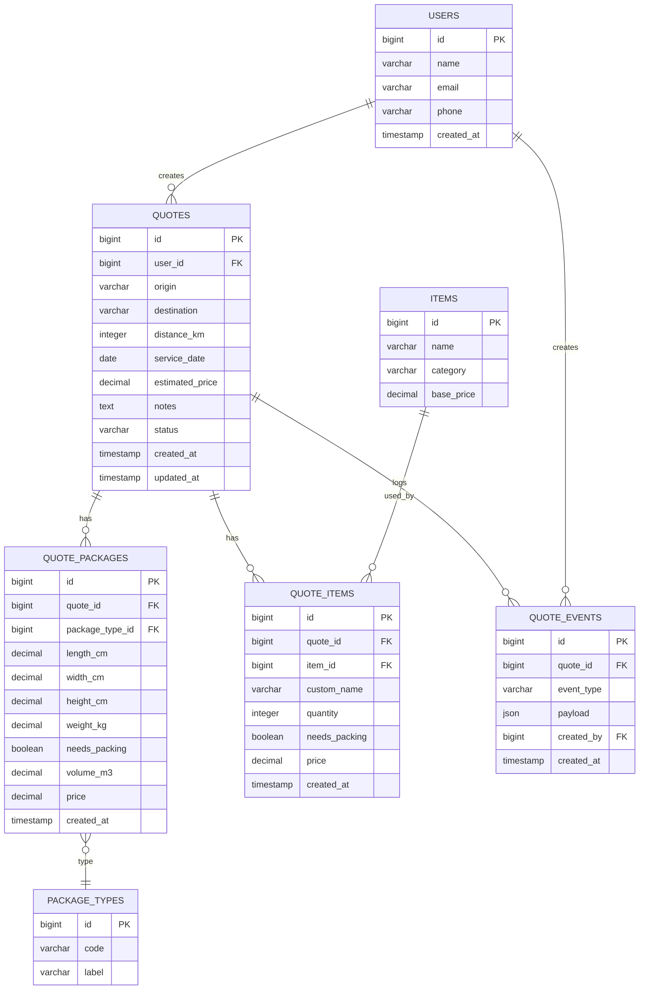

# Esquema de Base de Datos — Envío Rápido (Presupuestos)

Resumen
- Objetivo: almacenar solicitudes de presupuesto (interacciones) generadas desde la SPA, usuarios de contacto, bultos, ítems (predefinidos y personalizados), y auditoría básica.
- Diseño pensado para un RDBMS relacional (Postgres/MySQL). Incluye diagrama ER en Mermaid y sentencias DDL.

Mermaid — Diagrama ER

Notas del diagrama
- `quotes.status`: `draft`, `pending`, `confirmed`, `cancelled`.
- `package_types.code`: ejemplos `caja`, `maleta`.
- `items.category`: ejemplos `office`, `home`.
- `quote_items.item_id` y `quote_items.custom_name` pueden ser `NULL` para ítems completamente personalizados.
- En SQL, `quote_events.payload` se define como `JSONB`; en el diagrama se muestra como `json` para mantener compatibilidad con visores Mermaid menos recientes.
